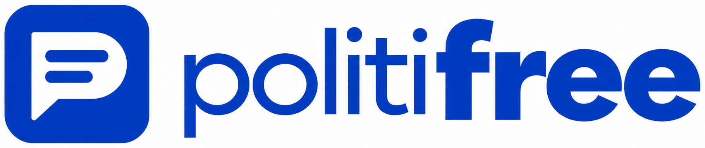

# Politifree local engine 0.6.17

Runs OCR, semantic classification, speech transcription and sampled video-frame OCR and visual scene classification on your computer. The production connection uses Chrome native messaging. It does not save uploaded content or send it to a cloud service. Initial setup downloads Python packages; model weights are included in the full companion package.

## Managed local engine

Use the combined Politifree installer. Chrome starts native_host.py through a
registered native messaging host when the extension needs analysis. The first
request loads the text model. OCR, vision and speech load only when needed;
unused media models are released independently during subsequent work. Idle timeout or Off closes the connection and releases
the process. No local HTTP listener, pairing token or sign-in task is needed.

The installer registers only the current extension identity, derived from its
Windows unpacked path (or a public key for a future Store build). This preserves
identity and settings when the installed folder stays the same.

server.py also contains the legacy HTTP development API. Its manual start/stop
scripts are retained for development compatibility and are not used by the
normal installer. Do not start that API for a regular installation.

## Behavior and tradeoffs

- OCR checks sufficiently large content images, excluding avatars, navigation and editing fields.
- Semantic analysis supplements explicit political text rules. It applies regardless of which viewpoint a post expresses. It is a pretrained model, not a model trained on this user's browsing.
- Downloadable media: speech is transcribed, video frames are sampled every two seconds plus keyframes. Clips exceeding two minutes or 32 MiB remain unverified. Images are capped at 10 MiB and 16 million pixels.
- Live audio: six-second chunks, analysed with two seconds of overlapping context, are withheld until locally checked. Chunks identified as political are suppressed. Failed or uncertain chunks play to avoid silencing ordinary audio without evidence. Audio is delayed and can be out of sync with visible video. Boundaries between chunks and model errors can still cause misses.
- Unchecked, inaccessible or unsupported media remains visible under the current precision policy. The legacy unchecked-content setting does not guarantee that these items are hidden.
- Protected video, closed shadow DOM, inaccessible canvases/frames and logins remain browser constraints. This cannot bypass authentication or guarantee removal of all politics. OCR, visual and semantic models can make mistakes.
- CPU analysis is bounded and cached in memory. Text-only browsing does not load OCR, vision or speech. Exact repeated audio windows reuse transcripts; repeated images and frames reuse context-aware results without reducing video sampling coverage. Memory depends on the models in use. No raw content is logged. Restarting clears in-memory caches.

## Resource management

Version 0.6.17 adds an in-memory LRU of at most 512 exact transformed text
windows. It retains all three hypothesis scores in their original order and
clears on unload. Changed windows still run inference; failures are not cached.
Image and audio hashing avoids redundant full-buffer copies. OCR reuses
unchanged-resolution pixels, and fully buffered native messages avoid another
bytearray and bytes copy. Fragmented reads preserve the existing behavior.
These changes do not change models, thresholds, coverage, or installed model
size. Performance gains depend on reuse; total model RAM remains significant.

The native connection uses a small controller and one inference worker. The
controller's health check does not import model libraries. Idle shutdown and
Off release the worker process. A worker above 1.5 GiB resident memory can be
recycled after a completed job, at least five minutes and eight analysis jobs
after startup. This is a recovery threshold, not a hard limit on inference peaks.
Model caches are lost on recycle, so recycling is deliberately infrequent.

The bundled visual reference vectors are derived from the same pinned text
encoder and labels. Runtime checks bind them to those inputs; a missing/stale
artifact falls back to the original encoder. Rebuild with
`python build_visual_references.py` after changing the visual model or labels.
The installer verifies the derived artifact with the other model checksums.

OCR evidence is cached independently of the caption, then fused with each new
caption. Video frames use decoded pixels without a PNG round trip. Speech uses
the same 30-second windows and two-second overlap in a reusable buffer. OCR
session spinning stops immediately after inference. No model, detection threshold, image resolution,
frame sampling or speech-window coverage is reduced by these optimizations.

Queues apply backpressure rather than declaring skipped media safe. Chrome
limits total native requests in flight to two. Already-materialized media in
browser messages and temporary decoder/inference allocations still consume
memory; the queue budget is not a whole-browser memory cap.

## Model and library sources

- Semantic model: [MoritzLaurer/deberta-v3-xsmall-zeroshot-v1.1-all-33](https://huggingface.co/MoritzLaurer/deberta-v3-xsmall-zeroshot-v1.1-all-33), quantized ONNX, MIT.
- Speech model: [Systran/faster-whisper-tiny.en](https://huggingface.co/Systran/faster-whisper-tiny.en), English, with [faster-whisper](https://github.com/SYSTRAN/faster-whisper), MIT.
- OCR: [RapidOCR](https://github.com/RapidAI/RapidOCR), installed from PyPI, Apache 2.0.
- Browser integration: [Chrome tabCapture](https://developer.chrome.com/docs/extensions/reference/api/tabCapture) and [offscreen documents](https://developer.chrome.com/docs/extensions/reference/api/offscreen).

For development-only source checkouts without the bundled models, download the semantic repository's `config.json`, `tokenizer.json` and `onnx/model_quantized.onnx` into `models/semantic/`, and the speech repository into `models/speech/` using `hf download`. The server never downloads models during inference.

## Visual evidence and combined decisions

CLIP image embeddings compete against political scenes and ordinary scenes (pets, food, sports, concerts, portraits and business presentations). Flags and crowds are not automatic political verdicts. Public-figure likeness prompts are evidence, not reliable face identification. Ambiguous visual results remain unverified unless strong text evidence resolves them. The visual score is a rule-based evidence level, not a calibrated probability. Centre cropping can miss details near an image's edge.

Image OCR and speech are classified together with the surrounding post caption. Evidence from multiple images and transcripts is combined in the extension for a final text decision. Strong individual signals cannot be diluted by ordinary filler. Failed or truncated analysis cannot become a cleared result.

Video samples every two seconds and at keyframes, up to two minutes. Very brief inserts between sampled frames can escape detection. Speech uses 30-second windows with two seconds of overlap. Live audio checks include the previous two seconds but play each cleared chunk only once; delays and phrase-boundary misses remain possible.

Visual weights: https://huggingface.co/Xenova/clip-vit-base-patch32 at revision 4c1807b705b1d015fb032789cc4d221b23025a6f. Model card included in models/visual/README.md. All bundled model hashes are recorded in model-manifest.json and verified during setup and startup. No repository Python code is executed.

## Repeatable evaluation

With Node.js installed and the sibling Politifree-Chrome folder present, run `.venv/Scripts/python.exe evaluate.py`. This uses evaluation/cases.json: 40 labelled text cases, 8 OCR fixtures, 4 generated clips, 2 speech fixtures and 2 sourced photographs. It passes model responses through the extension's production decision logic and reports political misses, false removals, unverified visible content and analysis latency. These are constructed English regression examples, not a representative accuracy estimate. No private browsing content is included. SOURCES.md records photograph attribution and licenses.
